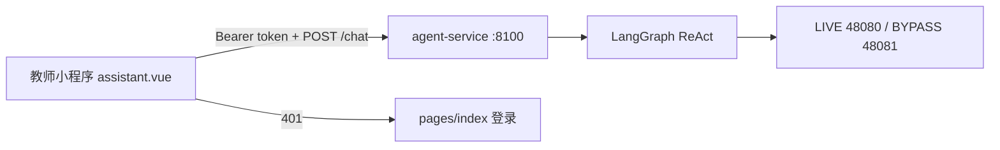

# 阶段 3：教师小程序助手入口

> 前置：阶段 0 清单、阶段 1 只读 tools、阶段 2 写入确认 + Web 聊天页（含账号登录）已完成。  
> 本阶段只补 **教师端 uni-app 问答入口**，不扩 tool 面。  
> 对照：`docs/agent-api-inventory.md`、Web 页 `agent-service/app/static/index.html`。

---

## 0. 目标

教师用小程序 **已登录账号** 打开助手，用自然语言完成阶段 1–2 已有能力（查询、创建课程/课堂/计划/考试、绑计划、改分、缺考），写入仍走确认卡。

Web 页已能登录与聊天；小程序 **不再做第二套登录**，复用 `uni.getStorageSync('token')`。



---

## 1. 范围

### 做

1. 新页面 `pages/assistant/assistant.vue`（聊天列表 + 输入 + 确认卡）
2. 入口：个人中心「教学助手」；首页可选悬浮入口。不新增第 6 个 tabBar（微信上限 5）
3. `services/agentChat.js`：封装 `POST /chat`，带 `Authorization`、`thread_id`、`approved`
4. 可配置 `AGENT_BASE_URL`（真机不能用 `127.0.0.1`）
5. 未登录 / token 失效：跳转登录页
6. Web 与小程序共用同一套 `/chat` 契约，不改写入 tool 语义

### 不做

- 新 tool、DELETE、上传、relay（阶段 4 / 5）
- 小程序内再做账号密码表单（已有 `pages/index`）
- 依赖微信 `EventSource` / SSE：小程序对分块流式不稳定，本阶段只用 **一次性 `POST /chat`**
- 改 gym_screen / yudao 后端

---

## 2. 关键决策

| 项 | 决定 |
|----|------|
| 鉴权 | 沿用小程序登录 token，请求头 `Authorization: Bearer` + Agent 再带 `Tenant-Id: 1` 打 admin-api |
| 传输 | `uni.request` → `POST {AGENT_BASE_URL}/chat`；流式留到阶段 5 再评估 |
| 会话 | `thread_id` 存 `uni.setStorageSync('agentThreadId')`；退出登录时清空 |
| 确认 | 响应含 `pending_confirmation` 时展示摘要 +「确认执行 / 取消」，再发 `{ thread_id, approved }` |
| 域名 | 开发者工具可关闭合法域名校验；真机 / 体验版须把 Agent 主机配进 request 合法域名，或走已备案反代 |

---

## 3. 实现要点

### 3.1 配置

在教师端增加一处 Agent 地址（建议 `services/agentChat.js` 顶部常量，与现有 `LIVE_API_BASE` 并列）：

```
AGENT_BASE_URL = http://<局域网IP>:8100
```

本机调试：电脑跑 uvicorn `0.0.0.0:8100`，手机与电脑同一 Wi-Fi，填电脑局域网 IP，不要填 `127.0.0.1`。

### 3.2 页面行为（对齐 Web）

| 交互 | 行为 |
|------|------|
| 进入页 | 无 token → 登录页；有 token 直接聊天（不必调 `/auth/login`） |
| 发送 | 用户气泡 + `POST /chat` `{ message, thread_id }` |
| 回复 | 助手气泡展示 `reply` |
| 确认卡 | 展示 `pending_confirmation.summary`；确认/取消后隐藏卡片 |
| 401 | `uni.removeStorageSync('token')` 并 `reLaunch` 到 `pages/index/index` |
| 网络失败 | toast「网络连接异常」，不丢本地已渲染气泡 |

文案与校验可对齐 Web：`agent-service/app/static/index.html`。

### 3.3 可选增强（本阶段有余力再做）

- 回复里的课程 / 考试 id 做成可点卡片，跳转已有页（`course-detail`、`exam-list` 等）
- 首页欢迎区右侧加「问助手」入口
- 将 Web 登录页与小程序字段提示保持一致（已基本一致）

### 3.4 Agent 服务可能的小改动

原则上 **零改 Python**。若联调需要：

- README 补充「小程序填局域网 IP:8100」
- 确认 CORS 已是 `*`（`app/main.py` 已有）
- 不要把 `/auth/login` 作为小程序主路径

---

## 4. 文件清单（预计）

| 路径 | 动作 |
|------|------|
| `badminton-teacher/pages/assistant/assistant.vue` | 新建聊天页 |
| `badminton-teacher/pages.json` | 注册页面 |
| `badminton-teacher/services/agentChat.js` | 新建 `/chat` 封装 |
| `badminton-teacher/pages/me/me.vue` | 增加入口 |
| `badminton-teacher/pages/home/home.vue` | 可选入口 |
| `agent-service/README.md` | 补充小程序联调 |

---

## 5. 验收

- [ ] 未登录进入助手 → 落到登录页
- [ ] 登录后问「我有哪些课程」→ 与 Web 同类回复，且走教师本人 token
- [ ] 「帮我创建课程：…」→ 确认卡出现；取消后 admin-api **无 POST**
- [ ] 确认后课程创建成功，小程序「我的课程」能看到
- [ ] 改分 / 缺考同样走确认卡
- [ ] token 过期发消息 → 回到登录，不白屏
- [ ] 开发者工具可跑通；真机需 Agent 可达（记一条联调说明即可）

**预估：** 2–4 天。

---

## 6. 风险

1. **微信合法域名**：http + IP 不能上正式版；本阶段按局域网开发处理。
2. **超时**：LangGraph + 百炼可能超过小程序默认超时，`uni.request` 建议 `timeout: 60000` 以上。
3. **进程内 MemorySaver**：Agent 重启后未确认操作丢失（阶段 5 再换持久化 checkpointer）。
