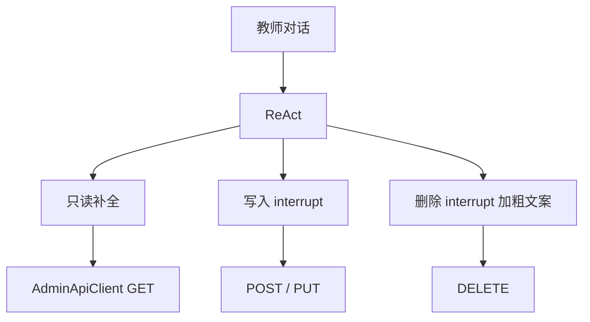

# 阶段 4：补齐教学 REST tools（编排 / 考核项 / 删除）

> 前置：阶段 3 小程序助手可用，或至少 Web 聊天页可用（本阶段主要改 `agent-service`）。  
> 目标：对话覆盖教师端 **其余 JSON REST**，仍不碰文件上传与大屏 WebSocket。  
> 对照：`docs/agent-api-inventory.md` §5–9、`services/trainingPlanApi.js`、`services/examApi.js`。

---

## 0. 目标

阶段 2 已有 12 只读 + 8 写入。本阶段补上计划项目编排、考核项配置、成绩重提/重考，以及带确认的 DELETE。完成后，教学平台 **非现场、非二进制** 的主路径都能用自然语言触发。

---

## 1. 范围

### 做

1. `AdminApiClient.delete(path, params)`
2. 只读补全（无 interrupt）
3. 写入补全（沿用 `interrupt`，未确认不打网关）
4. 删除 tools（确认摘要必须含对象名称 + id，系统提示允许删除但必须确认）
5. Mock LLM 关键词覆盖新意图；真实 LLM 更新 `SYSTEM_PROMPT`
6. 单测：interrupt 取消不发 HTTP；批准后路径/网关正确（LIVE vs BYPASS）

### 不做

- `plan-material/upload`、`exam-item-material/upload`、`exam-score/submit-video`（阶段 5）
- relay / gym_screen 命令（阶段 5）
- `exam-score/algo-callback`（内部接口，不对 Agent 开放）
- `examRecognition.js` 占位算法直连
- 签到 / 人脸（清单未列入教师端主流程）

---

## 2. Tool 清单

路径必须与前端实际调用一致，不要用设计文档里的别名。

### 2.1 只读补全

| Tool | Method / Path | 网关 | 参数 |
|------|---------------|------|------|
| `get_plan_project` | GET `/teaching/plan-project/get` | LIVE | `id` |
| `list_plan_projects_by_teacher` | GET `/teaching/plan-project/list-by-teacher` | LIVE | `teacherId` 注入 |
| `list_plans_by_lesson` | GET `/teaching/plan/list-by-lesson` | LIVE | `lessonId` |
| `list_plan_materials` | GET `/teaching/plan-material/list-by-item` | LIVE | `itemId`（plan-project id） |
| `get_plan_material` | GET `/teaching/plan-material/get` | LIVE | `id` |
| `list_exam_items` | GET `/teaching/exam-item/list-by-exam` | BYPASS | `examId` |
| `get_exam_item` | GET `/teaching/exam-item/get` | BYPASS | `id` |
| `get_exam_score` | GET `/teaching/exam-score/get` | BYPASS | `id` |
| `list_exam_item_materials` | GET `/teaching/exam-item-material/list-by-item` | BYPASS | **`examItemId`**（不要写成 itemId） |

### 2.2 写入（确认后执行）

| Tool | 对齐前端 | 要点 |
|------|----------|------|
| `create_plan_project` | `createPlanProject` | body 含 `teacherId`；**创建时不传 planId**，需要挂到计划时再 `associate` |
| `associate_plan_project` | `associatePlanProject` | `id` + `planId` |
| `update_plan_project` | `updatePlanProject` | 可改名称 / 时长等 |
| `arrange_plan_projects` | `saveTrainingPlanArrangement` | **一次确认**，内部多次 PUT `sortOrder`；args 为有序 id 列表 |
| `update_exam` | `updateExam` | 改标题 / `scoreRatio`；注意 `exam_ratio_exceeded` |
| `create_exam_item` | `createExamItem` | `examId, itemName, maxScore, weight, algoType, sortOrder?` |
| `update_exam_item` | `updateExamItem` | 权重合计校验失败时把后端 `msg` 原样返回 |
| `create_exam_item_material` | `createExamItemMaterial` | 仅元数据，不传文件 |
| `retry_exam_score` | `retryExamScore` | POST `/teaching/exam-score/retry` |
| `restart_exam_student` | `restartExamStudent` | POST `/teaching/exam-score/restart-student` |

`create_plan_project` + `associate_plan_project` 可被 LLM 连调；不要做成「创建时偷偷带 planId」，以免和现网行为不一致。

### 2.3 删除（确认文案必须醒目）

| Tool | Path | 网关 |
|------|------|------|
| `delete_course` | DELETE `/teaching/course/delete` | LIVE |
| `delete_lesson` | DELETE `/teaching/lesson/delete` | LIVE |
| `delete_training_plan` | DELETE `/teaching/plan/delete` | LIVE |
| `delete_plan_project` | DELETE `/teaching/plan-project/delete` | LIVE |
| `delete_exam` | DELETE `/teaching/exam/delete` | BYPASS |
| `delete_exam_item` | DELETE `/teaching/exam-item/delete` | BYPASS |
| `delete_exam_item_material` | DELETE `/teaching/exam-item-material/delete` | BYPASS |

`plan-material/delete`：前端已注释未用。本阶段 **默认不做**；若 Knife4j 确认后端可用，再单列并在确认文案标明「前端未启用」。

删除确认摘要模板：`将永久删除{类型}「{名称}」（id={id}），此操作不可恢复。`

---

## 3. 实现要点

### 3.1 HTTP 客户端

在 `agent-service/app/client/admin_api.py` 增加 `delete`：query 用 `params`（前端是 `?id=`），解析仍走 `{ code, data, msg }`。

### 3.2 工具数量与选中率

本阶段会把 tool 从约 20 个扩到约 40 个，LLM 选错风险上升。约束：

- 每个函数 docstring 写清 **何时用 / 何时不要用**（例如删除项目 vs 解除关联：现网 `disassociate` 也是 DELETE 项目）
- `SYSTEM_PROMPT` 改为：允许删除，但必须等确认；缺 id 先用只读 tool 查，禁止编造 id
- Mock 模型按关键词路由：编排 / 考核项 / 删除
- 若联调发现经常选错，再拆子图（阶段 5 可做 router），本阶段先不加复杂度

### 3.3 编排 tool 的事务性

`arrange_plan_projects` 一次确认后循环 PUT。中途失败：返回已成功的 id 与失败项，**不要静默重试打乱顺序**。提示教师到小程序「训练项目编排」页核对。

### 3.4 考试占比

`update_exam` / `create_exam` 失败时保留后端 `msg`（如占比超限）。不要在 Agent 里硬编码占比上限，除非与 `examApi.calcScoreRatioUsage` 对齐后再做预校验。

---

## 4. 文件清单（预计）

| 路径 | 动作 |
|------|------|
| `agent-service/app/client/admin_api.py` | 增加 `delete` |
| `agent-service/app/tools/registry.py` | 只读补全 |
| `agent-service/app/tools/writes.py` | 写入补全 |
| `agent-service/app/tools/deletes.py` | 新建删除 tools |
| `agent-service/app/graph/workflow.py` | 更新系统提示（允许删除） |
| `agent-service/app/llm.py` | Mock 关键词 |
| `agent-service/tests/test_writes.py` / `test_deletes.py` | 取消不发请求；删除走 DELETE |
| `agent-service/tests/test_gateway.py` | 新路径 LIVE/BYPASS 分流 |
| `docs/agent-api-inventory.md` | 勾选阶段 4 完成项 |

Web / 小程序确认卡 **无需改协议**（仍用 `pending_confirmation`）。

---

## 5. 验收

- [ ] 问「某计划下有哪些训练项目」→ `list_plan_projects`
- [ ] 「把热身加到计划 X」→ 确认后 create（无 planId）+ associate
- [ ] 「把计划 X 的项目排成：热身、步伐、多球」→ 一次确认，多次 PUT `sortOrder`
- [ ] 「给考试 Y 加考核项 高远球 满分 10 权重 0.5」→ BYPASS `exam-item/create`
- [ ] 「删除课程 Z」→ 确认卡含名称与 id；取消后无 DELETE
- [ ] 考试相关新 tool 打 48081，课程/计划打 48080（单测锁死）
- [ ] pytest 全绿；Web 与小程序各走通 1 条写入 + 1 条删除（可用测试课，避免删生产数据）

**预估：** 4–6 天。

---

## 6. 风险

1. **误删**：确认文案必须可读；系统提示禁止在用户未点名对象时调用 delete。
2. **create 返回 Long id**：与阶段 2 相同，tool 返回 `{ created, ...payload }` 便于下一轮 associate。
3. **参数名**：考核资料列表是 `examItemId`，计划资料是 `itemId`，混用会 400。
