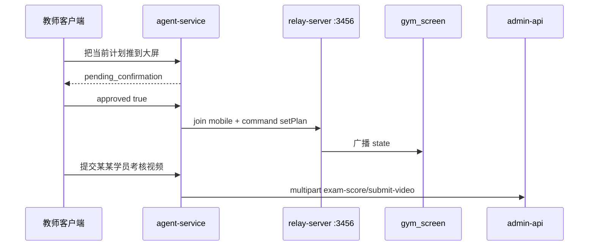

# 阶段 5：现场能力、上传与打磨

> 前置：阶段 4 REST 主路径已进对话。  
> 本阶段才接入 **relay WebSocket**、**multipart 上传**，并把 Agent 从「能演示」收到「能进场地」。  
> 对照：`relay-server/README.md`、`pages/screen-control/screen-control.vue`、`pages/exam-room/exam-room.vue`、`docs/agent-api-inventory.md` §7 / §9 / §10。

---

## 0. 目标

教师可以用对话：下发训练计划到大屏、暂停/切项、进入考试 briefing / 开始考试 / 切考生；以及提交考核视频、上传计划资料。所有现场命令与上传均需确认。同时补上进程重启丢确认态、操作审计等生产缺口。



---

## 1. 范围

### 做

1. Agent 内 `RelayClient`（WS）：join `role=mobile`，发 `command`，收 `state` / `error`
2. 训练 + 考试 relay tools（高风险，一律 interrupt）
3. multipart：计划资料上传、考试成绩 `submit-video`（禁止直连算法 IP）
4. Checkpointer 持久化（替换进程内 `MemorySaver`）
5. 已确认写入 / 遥控的审计日志
6. 可选：Web 结构化卡片、流式输出在 H5 上启用（小程序仍可用非流式）

### 不做

- 把 LangGraph 塞进 `yudao-module-ai` 或 JDK8 后端
- Agent 直连动作识别服务（必须走 `exam-score/submit-video`）
- 微信一键登录（小程序页有入口但是演示级）
- 签到人脸模块

---

## 2. Relay 接入

### 2.1 连接约定

与小程序一致（`utils/relayConfig.js`）：

| 项 | 默认 |
|----|------|
| URL | `ws://<host>:3456` |
| 房间 / 令牌 | 预置 `1001` / `2002`（可用环境变量覆盖） |
| join | `{ type: join, role: mobile, roomId, token }` |
| 命令 | `{ type: command, name, payload }` |

Agent **代教师发命令**，不替代大屏 `display` 角色。大屏须先 join。探测仍可用 HTTP `GET /relay-info`（protocol v2）。

配置建议（`agent-service` `.env`）：

```
RELAY_WS_URL=ws://10.x.x.x:3456
RELAY_ROOM_ID=1001
RELAY_TOKEN=2002
```

房间不写进 LLM 对话除非教师明确说换房。

### 2.2 训练命令 tools

| Tool | relay `name` | 说明 |
|------|--------------|------|
| `relay_set_plan` | `setPlan` | payload 对齐 `screen-control`：从 `list_plan_projects` + 资料 URL 组装 `plan[]`；带 `mediaBearerToken`（当前教师 JWT）供 `/media-proxy` |
| `relay_pause` / `relay_resume` | `pause` / `resume` | |
| `relay_set_current_item` | `setCurrentItem` | |
| `relay_set_item_duration` | `setItemDuration` | |
| `relay_reset_block_timer` | `resetBlockTimer` | |
| `relay_toggle_video` 等 | 与 README 一致 | 按需，不必第一轮全做 |

考试态下训练命令会被中继拒绝（`mode_conflict`）。tool 应把错误原文返回，提示「请先结束考试」。

### 2.3 考试命令 tools

| Tool | relay `name` |
|------|----------------|
| `relay_set_exam_briefing` | `setExamBriefing`（items 用 `buildExamBriefingItems` 同款数据，Agent 内用已有 exam-item / material 只读 API 组装） |
| `relay_set_exam_item` | `setExamItem` |
| `relay_start_exam` | `startExam`（examinees 来自名册） |
| `relay_set_current_examinee` | `setCurrentExaminee` |
| `relay_advance_examinee` | `advanceExaminee` |
| `relay_mark_examinee_absent` | `markExamineeAbsent`（与 REST `mark_exam_absent` 是两层：大屏态 vs 成绩库，确认文案写清） |
| `relay_restart_examinee` | `restartExaminee` |
| `relay_finish_exam` | `finishExam` |
| `relay_exit_exam_mode` | `exitExamMode` |

`startExam` / `finishExam` / `exitExamMode` 确认摘要必须写清不可逆影响。

### 2.4 连接生命周期

- 每个 chat 请求内：需要遥控时再 connect → join → command → 读一轮 state → close；或按 `thread_id` 短缓存连接（注意 uvicorn 多 worker 不能共享 WS）
- **第一轮建议：单 worker + 请求内短连接**，避免 MemorySaver 式的隐性状态
- join 失败、15s 未 join、`mode_conflict`：转为对教师可读的中文，不抛栈

---

## 3. 上传

`AdminApiClient` 增加 `post_multipart`。文件不要经 LLM：由 **客户端先选文件**，再把本地路径/临时文件交给 Agent HTTP；纯对话场景只支持「对已有资料 id 做绑定」。

推荐 API 形态（避免把二进制塞进 `/chat` JSON）：

1. `POST /files/upload-plan-material`（Bearer + multipart）→ 内部调 LIVE `/teaching/plan-material/upload`，再 `create` 元数据  
2. `POST /files/submit-exam-video` → BYPASS `/teaching/exam-score/submit-video`（字段与 `submitExamScoreVideo` 一致：`file` + `examId` + `examItemId` + `studentId` …）

对话里 LLM 只调用「已上传 / 请用户走上传接口」类 tool，或 Web/小程序在确认后由前端直接打上述 `/files/*`。

**禁止：** Agent 把视频转到算法机 IP；必须走旁路 `submit-video`。

考核资料文件：现网优先 LIVE `plan-material/upload`，失败再 BYPASS `exam-item-material/upload`（见清单 §1 例外）。Agent 上传实现复制该降级顺序。

---

## 4. 打磨

| 项 | 做法 |
|----|------|
| Checkpointer | `SqliteSaver` 或 Redis；重启后同一 `thread_id` 仍能 resume 确认 |
| 审计 | 每次确认后的 POST/PUT/DELETE/relay command 写本地 jsonl：时间、teacherId、tool、args 摘要、成功/失败 |
| 系统提示 | 现场命令前先确认大屏已开、房间号默认 1001 |
| Web | H5 可接 `POST /chat/stream`；确认卡保持不变 |
| 小程序 | 维持非流式；上传用 `uni.uploadFile` 打 Agent `/files/*` |
| 字段校准 | 用 LIVE/BYPASS Knife4j `/v3/api-docs` 核对阶段 4–5 仍在用的字段名（阶段 0 可选债） |
| Tool 过多 | 若选中率差：按意图加一层 router（查询 / 教务写入 / 现场遥控），再进对应 tool 子集 |

---

## 5. 文件清单（预计）

| 路径 | 动作 |
|------|------|
| `agent-service/app/client/relay_ws.py` | 新建 WS 客户端 |
| `agent-service/app/tools/relay.py` | 新建遥控 tools |
| `agent-service/app/client/admin_api.py` | `post_multipart` |
| `agent-service/app/api/files.py` | 上传代理 |
| `agent-service/app/graph/workflow.py` | 持久化 checkpointer + 提示 |
| `agent-service/app/audit.py` | 审计日志 |
| `agent-service/.env.example` | `RELAY_*` |
| `agent-service/tests/test_relay.py` | mock WS：未确认不发 command |
| `pages/assistant/assistant.vue` | 选视频 / 选文件后调 `/files/*`（若阶段 3 已有页面） |
| `docs/agent-api-inventory.md` | 勾选 v3 / 阶段 5 |

---

## 6. 验收

- [ ] 大屏已开、中继 protocol v2：对话「把我的计划 X 推到大屏」→ 确认 → gym_screen 出现项目列表
- [ ] 「暂停大屏」→ 确认 → 大屏暂停；考试模式下训练暂停返回 `mode_conflict` 中文说明
- [ ] 「开始考试」→ 确认 → `examPhase=running`；finish / exit 同样需确认
- [ ] 缺考：说清是改成绩库还是只改大屏队列
- [ ] 上传一条计划资料 / 提交一条考核视频，文件落到现网约定存储，成绩或资料列表可见
- [ ] 重启 agent-service 后，未点确认的 thread 仍能 resume（持久化 checkpointer）
- [ ] 审计文件能对应到一次 setPlan / 一次 delete
- [ ] 不出现 Agent 直连算法 IP

**预估：** 5–8 天（含场地联调）。

---

## 7. 风险

1. **副作用**：错误 `setPlan` 会打断正在上课的大屏。确认卡必须展示计划标题与房间号。
2. **媒体鉴权**：`setPlan` / briefing 必须带教师 `mediaBearerToken`，否则大屏 `<video>` 拉不到需登录的片。
3. **多 worker**：WS 连接不能跨进程；阶段 5 默认单进程 uvicorn，或遥控只走「请求内短连接」。
4. **小程序 socket 合法域名**：生产需 wss；Agent 代发命令可让手机 **不必直连中继**（这是本阶段的产品价值之一）。
